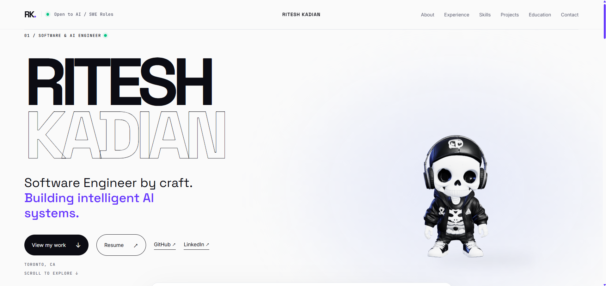

# Ritesh Kadian Portfolio


## Start locally

1. Open PowerShell in this folder.
2. Run:

   ```powershell
   python -m http.server 8000
   ```

3. Open: **http://localhost:8000**

Stop the server with `Ctrl+C`.